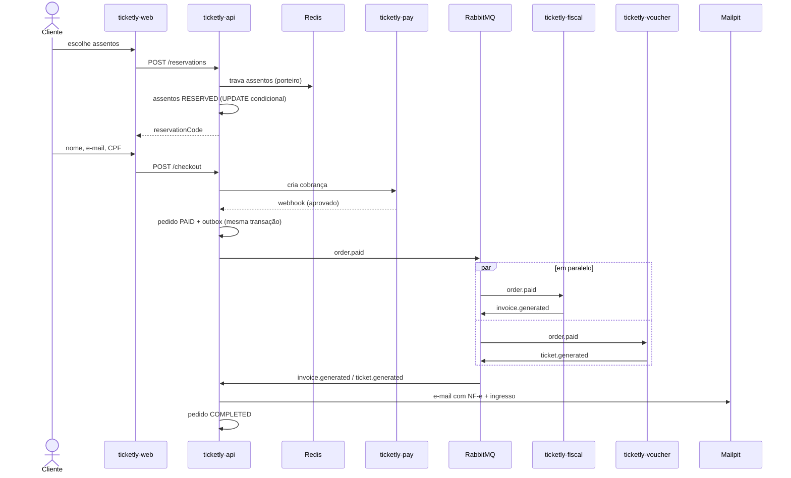
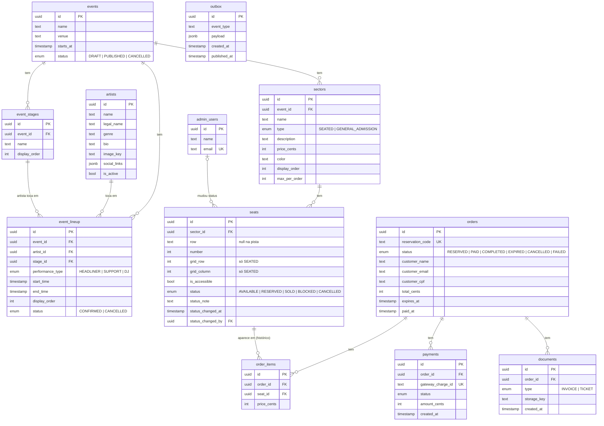

# Arquitetura

## Fluxo de uma compra



### Passo a passo

1. **Reserva** — sem login, o cliente escolhe os assentos (setor `SEATED`) ou a quantidade (pista, `GENERAL_ADMISSION`: a API pega os primeiros livres). A API trava cada assento no Redis (`SET NX EX`), muda o assento pra `RESERVED` no Postgres com um UPDATE condicional e cria um pedido `RESERVED` com um `reservationCode` aleatório. Quem tem esse código é o dono da reserva. O prazo é `RESERVATION_HOLD_MINUTES` (10). O cliente pode desistir (`DELETE /reservations/:reservationCode`).
2. **Checkout** — o cliente envia nome, e-mail, CPF e o `reservationCode`. A API cria a cobrança no gateway e estende o prazo do pedido pra `PAYMENT_HOLD_MINUTES` (30), porque o Pix demora.
3. **Pagamento** — o gateway fake chama o webhook da API (aprovado ou recusado, com atraso aleatório).
4. **Publicação** — a API marca o pedido como `PAID` e grava o evento na tabela `outbox` **na mesma transação**. Um job publica a outbox no RabbitMQ.
5. **Processamento paralelo** — fiscal e voucher recebem cada um sua cópia de `order.paid`, geram o PDF, sobem no storage e publicam o resultado.
6. **Fulfillment** — a API registra cada documento. Quando os dois existem, envia o e-mail e marca `COMPLETED`.

### Status do pedido

```
RESERVED ──► PAID ──► COMPLETED
    │          │
    ├─► EXPIRED
    ├─► CANCELLED
    ▼          ▼
  FAILED     FAILED
```

- `EXPIRED`: não pagou no prazo (`expires_at`). Um job devolve os assentos pra `AVAILABLE`.
- `CANCELLED`: o cliente desistiu da reserva. Os assentos voltam pra `AVAILABLE`.
- `FAILED`: pagamento recusado ou erro definitivo no processamento.
- Os itens do pedido **nunca são apagados**: ficam como histórico de quem reservou ou comprou cada assento.

## Setores e assentos

O evento tem **setores** e cada setor tem **assentos**: uma linha por ingresso vendável.

| Tipo de setor | Na loja | No admin | Assento |
|---|---|---|---|
| `SEATED` (lugar marcado) | cliente escolhe na grade | grade de quadradinhos, gerada por blocos | fileira + número + posição na grade (`grid_row`, `grid_column`) |
| `GENERAL_ADMISSION` (pista) | cliente escolhe a quantidade | contadores por status | só número sequencial (`row` e `grid_*` vazios) |

### Status do assento

```
              reserva                 pagamento aprovado
AVAILABLE ───────────────> RESERVED ──────────────────────> SOLD
    ^                          │
    └──────────────────────────┘
   desistiu / expirou / pagamento recusado

AVAILABLE <──── desbloquear / bloquear ────> BLOCKED

AVAILABLE ──── cancelar (com observação) ───> CANCELLED   (definitivo)
```

- `BLOCKED`: fora de venda temporariamente (produção, cortesia, visão obstruída). Exige observação.
- `CANCELLED`: criado indevidamente; nunca volta. Só sai de `AVAILABLE` e exige observação.
- `SOLD` é definitivo (sem reembolso por enquanto).
- **Assento nunca é excluído.** Setor só é excluído se não tiver assento.
- O admin muda status por ação com nome (`/block`, `/unblock`, `/cancel`), nunca por `PATCH { status }`.

### Venda dupla: Redis + Postgres

1. **Redis (porteiro):** `SET seat:{id} NX EX` barra em microssegundos quem chegou depois, sem incomodar o banco na abertura das vendas.
2. **Postgres (garantia):** `UPDATE seats SET status = 'RESERVED' WHERE id = ? AND status = 'AVAILABLE'`. Se afetar 0 linhas, alguém pegou antes → 409. Cobre o dia em que o Redis cair ou perder as travas.

A expiração é feita por um job que olha `orders.expires_at` no Postgres; o TTL do Redis só limpa a trava dele.

### Evento

- `DRAFT → PUBLISHED` exige pelo menos 1 assento `AVAILABLE`.
- Evento com setores não é excluído, é **cancelado** (`CANCELLED`), e só se não houver assento `SOLD` nem `RESERVED`. Na prática: volta pra `DRAFT` (sai da loja), espera as reservas expirarem e cancela.
- Palcos são cadastrados por evento (`event_stages`) e o lineup escolhe um deles. O assento não se liga a palco.

## Decisões

| Decisão | Por quê |
|---|---|
| Compra sem login | A reserva pertence ao pedido (via `reservationCode`), não a um usuário. Login só no admin. |
| Postgres só da API | Cada banco tem um dono só. Os workers não acessam o banco — tudo que precisam vem na mensagem. |
| Outbox | Garante que o evento só é publicado se o pedido foi salvo, e que não se perde se o RabbitMQ estiver fora. |
| Uma fila por worker | Cada worker recebe sua própria cópia da mensagem e processa em paralelo. |
| Envelope JSON próprio | Formato neutro entre Node e Python. Por isso não usamos o transport nativo do `@nestjs/microservices`. |
| Idempotência via Redis | O RabbitMQ pode entregar a mesma mensagem duas vezes. Cada worker anota `processed:{messageId}`. |
| Junção atômica | Os dois resultados podem chegar ao mesmo tempo. Um `UPDATE` condicional garante que só um deles dispara o e-mail. |
| Arquivos num storage S3 | Nada de pasta compartilhada entre containers. A mensagem carrega só a chave do arquivo. |
| Storage nomeado pelo papel, não pelo produto | Os serviços falam S3 com `http://storage:9000` e nunca citam o programa. Só a infra sabe que é o Silo — trocar de produto não mexe em nenhum outro repositório. |
| Silo no lugar do MinIO | O MinIO parou de publicar imagens gratuitas (out/2025) e foi arquivado (abr/2026). O Silo é o fork comunitário mantido pelo Pigsty: mesma API, mesmas variáveis `MINIO_*`, imagens atualizadas. Plano B: RustFS. |
| Arquivos privados por padrão | NF-e e ingresso têm CPF: bucket privado, acesso só por URL assinada (link temporário gerado pela API). Só `ticketly-public/artists/` é público. |
| Dinheiro em centavos (`int`) | Evita erro de arredondamento. `15000` = R$ 150,00. |
| Retry + DLQ | Falha temporária tenta de novo com espera; falha repetida vai pra uma fila de "mortos" para análise. |
| MikroORM | Unit of Work parecido com o Entity Framework (`em.flush()` ≈ `SaveChanges()`). |

## Modelo de dados (ticketly-api)



Regras importantes:

- `order_items` **nunca é apagado** e `seat_id` **não é único**: o mesmo assento aparece em vários pedidos ao longo do tempo (um expirou, outro comprou). Quem impede venda dupla é o `seats.status` (ver "Venda dupla").
- `order_items.price_cents` é o preço do momento da reserva: mudar o preço do setor não mexe em quem já reservou ou comprou.
- `seats` tem dois índices únicos **parciais**, que só valem pra assento não cancelado (assim dá pra recriar um assento cancelado por engano). Escritos à mão na migration, porque o `@Unique` do MikroORM não gera `WHERE`:
  - `(sector_id, row, number) NULLS NOT DISTINCT WHERE status <> 'CANCELLED'`: o `NULLS NOT DISTINCT` faz o `row` vazio da pista contar como igual; sem ele daria pra ter dois "Pista 5".
  - `(sector_id, grid_row, grid_column) WHERE status <> 'CANCELLED'`: dois assentos não ocupam o mesmo quadradinho.
- CHECKs em `seats`: `number > 0`; `grid_row`/`grid_column` os dois juntos ou nenhum; `status_note` obrigatório se `BLOCKED`/`CANCELLED`. Em `sectors`: `price_cents >= 0`; `max_per_order` nulo ou `> 0`.
- Únicos: `sectors (event_id, name)` e `event_stages (event_id, name)`.
- Apagar: `events → sectors → seats` é tudo `RESTRICT` (assento nunca some; o service devolve 409 antes). `event_stages` cai junto com o evento (`CASCADE`), mas palco usado no lineup é `RESTRICT`.
- `documents` é único por `(order_id, type)`: um pedido tem no máximo uma NF-e e um ingresso.
- `event_lineup` é único por `(event_id, artist_id)`: o mesmo artista não entra duas vezes no lineup de um evento. Apagar o evento apaga o lineup (`ON DELETE CASCADE`); apagar um artista que está em algum lineup é recusado (`ON DELETE RESTRICT`, a API devolve 409).
- `outbox` não se relaciona com nada: é a caixa de saída de mensagens para o RabbitMQ.

## Infraestrutura compartilhada

| Serviço | Uso | Quem usa |
|---|---|---|
| RabbitMQ | Mensagens entre serviços | api, fiscal, voucher |
| Redis | Lock de assento, idempotência, cache de etapas | api, fiscal, voucher |
| Storage S3 (Silo) | Fotos dos artistas e PDFs | api (fotos, lê os PDFs), fiscal e voucher (gravam PDFs) |
| Mailpit | Caixa de e-mail falsa para ver os e-mails enviados | api |

Tudo isso sobe pelo [`ticketly-infra`](../ticketly-infra). O Postgres não está aqui: ele é da API.

### Buckets

| Bucket | Acesso | Prefixos |
|---|---|---|
| `ticketly-public` | Leitura pública **só** em `artists/` | `artists/<uuid>.<ext>` — fotos dos artistas<br>`tmp/<uuid>.<ext>` — uploads ainda não confirmados; apagados sozinhos depois de 1 dia (regra de lifecycle) |
| `ticketly-documents` | Privado (URL assinada) | `invoices/<orderId>.pdf` — NF-e<br>`tickets/<orderId>.pdf` — ingressos |

Regras:

- O banco guarda só a **chave** (`artists/abc.webp`), nunca a URL completa.
- A chave é gerada pela API ou pelo worker (`<prefixo>/<uuid>`), nunca o nome original do arquivo.
- "Pastas" não existem de verdade no S3: o prefixo aparece quando o primeiro arquivo é salvo. Não precisa criar nada além dos buckets.
