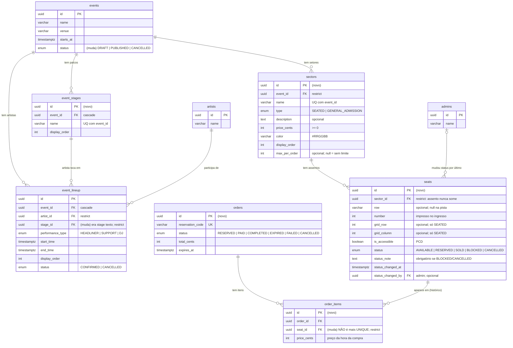

# Esboço do banco — setores, assentos e palcos

Sempre atualizado com o plano de `setores-e-assentos.md`. Mostra só as tabelas ligadas a esse assunto.

Legenda nos comentários: **(novo)** = tabela ou coluna que ainda não existe · **(muda)** = já existe e vai mudar.

## Regras que o diagrama não mostra

- **Índices únicos parciais em `seats`** (só valem pra assento não cancelado):
  - `(sector_id, row, number) NULLS NOT DISTINCT WHERE status <> 'CANCELLED'`: não existem dois "C-12" ativos no setor, nem dois "Pista 5" (o `NULLS NOT DISTINCT` faz `row` null contar como igual).
  - `(sector_id, grid_row, grid_column) WHERE status <> 'CANCELLED'`: não existem dois assentos no mesmo quadradinho do mapa (pista, com grid null, fica de fora).
- **Reserva sem venda dupla:** `UPDATE seats SET status = 'RESERVED' WHERE id = ? AND status = 'AVAILABLE'`. Se afetar 0 linhas, alguém pegou antes → 409.
- **Nada de `order_items` é apagado:** quando a reserva expira, o pedido vira `EXPIRED` e o assento volta pra `AVAILABLE`, mas o item fica como histórico.
- `orders` e `order_items` aparecem resumidos aqui; o resto das colunas está no `docs/arquitetura.md`.
