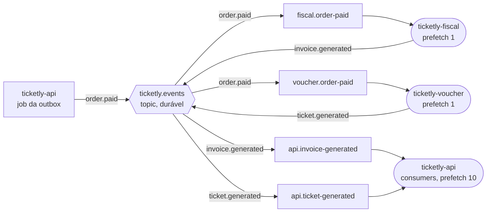
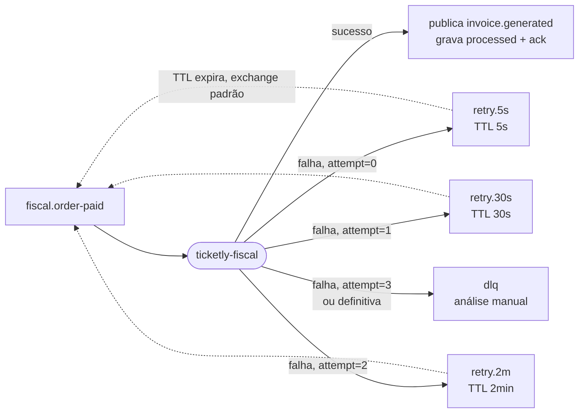
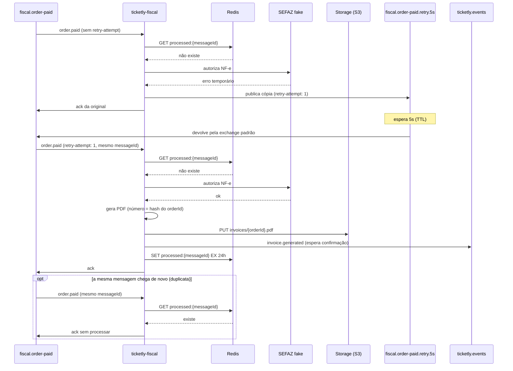

# Mensageria — diagramas

Visão técnica do RabbitMQ e dos workers. O contrato das mensagens está em [eventos.md](eventos.md) e o porquê de cada escolha em [decisoes.md](decisoes.md).

## Topologia

Uma exchange `topic` e uma fila por consumidor. Cada fila recebe sua própria cópia da mensagem.

## Retry e DLQ de uma fila

Mesmo desenho para as 4 filas; abaixo, a do fiscal. Os nomes das filas auxiliares são abreviados: `retry.5s` = `fiscal.order-paid.retry.5s`, e assim por diante. Nenhuma fila de espera tem consumidor. `attempt` = header `retry-attempt`.

- Ao falhar, o worker publica a cópia no degrau com `retry-attempt` + 1 e depois dá ack na original.
- A volta (linha tracejada) vai direto para `fiscal.order-paid` pela exchange padrão, **não** pela `ticketly.events` — senão o voucher recebe de novo.
- Falha definitiva (payload inválido, CPF mágico `00000000000`) pula o retry e vai direto para a DLQ.

## Worker com falha temporária

O fiscal falha na 1ª tentativa (SEFAZ fake fora do ar), espera no degrau de 5s e conclui na 2ª.

- `S` é um módulo dentro do próprio fiscal (simula a SEFAZ), não um serviço separado.
- `processed` só é gravado **no fim**: se o worker cair antes, a mensagem volta e é refeita. Refazer é inofensivo porque a chave do arquivo e o número da NF-e dependem só do `orderId`.
